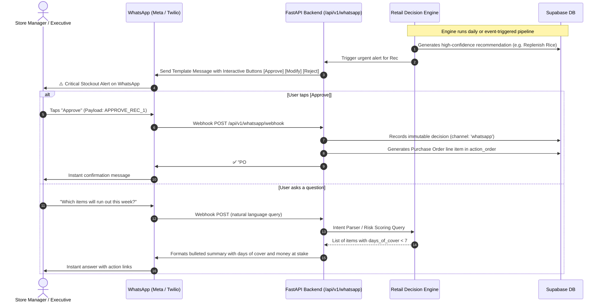

# WhatsApp Integration & Bot Guide
## Autonomous Retail Decision Intelligence (Theme 2: AI for Business)

This guide explains how to connect WhatsApp for real-time critical decision alerts and a two-way conversational bot that lets store managers and executives ask questions and approve store actions directly from their phones.

---

### 1. How the WhatsApp Decision Loop Works



---

### 2. Option A: Connecting Meta WhatsApp Business Cloud API (Official & Production)

1. **Meta Developer Console**:
   - Go to [https://developers.facebook.com](https://developers.facebook.com) and create a **Business App**.
   - Add the **WhatsApp** product.
   - Obtain your **Temporary Access Token** and **Phone Number ID**.

2. **Configure Webhook**:
   - In WhatsApp > Configuration > Callback URL:
     - Enter: `https://your-public-domain.ngrok-free.app/api/v1/whatsapp/webhook`
     - Verify Token: Set a random secret string (e.g., `retail_decision_intelligence_token_2026`).
     - Subscribe to the `messages` event.

3. **Set Environment Variables in `server/.env`**:
   ```env
   WHATSAPP_PROVIDER=meta
   META_WA_TOKEN=EAA...your_bearer_token...
   META_WA_PHONE_NUMBER_ID=109283746501928
   META_WA_VERIFY_TOKEN=retail_decision_intelligence_token_2026
   ```

---

### 3. Option B: Twilio WhatsApp API (Easiest for Hackathons in 2 minutes)

1. **Get Free Twilio Account**: Go to [https://twilio.com](https://twilio.com).
2. **Join Sandbox**: Go to **Messaging** > **Try WhatsApp**. Send the join code (e.g. `join bright-river`) from your personal phone to Twilio's WhatsApp number.
3. **Set Webhook**:
   - In Twilio Sandbox Settings > "When a message comes in":
     - Enter: `https://your-domain.ngrok-free.app/api/v1/whatsapp/webhook` (HTTP POST).
4. **Set Environment Variables in `server/.env`**:
   ```env
   WHATSAPP_PROVIDER=twilio
   TWILIO_ACCOUNT_SID=AC...
   TWILIO_AUTH_TOKEN=...
   TWILIO_WA_NUMBER=whatsapp:+14155238886
   ```

---

### 4. Natural Language Queries Supported by the Bot

Managers can text any of these questions directly:
- *"Which items will run out this week?"* → Returns ranked stockout risks.
- *"Show excess inventory"* → Returns items with days of cover exceeding target buffer.
- *"What is our service level?"* → Returns current service level vs target (e.g., 96.8% vs 95.0%).
- *"Approve recommendation 1"* or tapping the [Approve] button → Creates PO and updates dashboard in real-time.
- *"Why mark down Celebration Gift Box?"* → Returns plain-language rationale based on shelf-life and holding cost.

---

### 5. Built-in Hackathon Interactive Simulator

For your live demo, we have also built an **Interactive WhatsApp Bot Simulator** directly into the web dashboard tab:
- It connects directly to the FastAPI `/api/v1/whatsapp/chat` endpoint.
- Displays WhatsApp-styled green chat bubbles, real timestamps, and interactive action buttons.
- The judges can see real incoming alerts, type natural questions, and tap buttons to approve actions live without waiting for SMS delivery delays!

